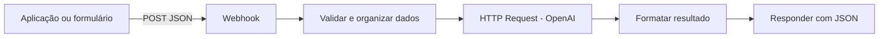

# Automação de Triagem de Solicitações com IA

Projeto de automação no **n8n** para receber solicitações por webhook, validar os dados, utilizar a API da OpenAI para sugerir uma classificação e devolver um resultado estruturado em JSON.

> **Status:** modelo de workflow preparado para importação e configuração. Antes de apresentar como funcional em produção, importe no seu n8n, configure as credenciais e execute os testes descritos neste README. A integração depende de uma chave válida da API da OpenAI.

## Objetivo

Demonstrar como ferramentas de automação e Inteligência Artificial podem apoiar a triagem inicial de solicitações recebidas por uma aplicação ou formulário.

A automação recebe os dados do solicitante, verifica os campos obrigatórios, envia o conteúdo para um modelo de IA e organiza o resultado em categorias e níveis de prioridade. A classificação é uma **sugestão automática** e deve ser revisada por uma pessoa antes de decisões importantes.

## Funcionalidades

- Recebimento de solicitações por Webhook HTTP `POST`.
- Validação dos campos `assunto` e `mensagem`.
- Organização dos dados do solicitante.
- Integração com a API da OpenAI por meio do node HTTP Request.
- Sugestão de categoria: `financeiro`, `técnico`, `cadastro`, `comercial` ou `outros`.
- Sugestão de prioridade: `baixa`, `média` ou `alta`.
- Geração de resumo, justificativa e resposta sugerida.
- Retorno de um JSON ao sistema que enviou a solicitação.
- Tratamento básico de falhas da API e de respostas inesperadas.

## Tecnologias e conceitos

| Tecnologia/conceito | Uso |
|---|---|
| n8n | Orquestração visual do workflow |
| Webhook | Recebimento de solicitações via HTTP |
| HTTP Request | Comunicação com a API da OpenAI |
| OpenAI API | Análise e classificação textual |
| JSON | Formato dos dados de entrada e saída |
| JavaScript | Validação e transformação de dados nos nodes Code |
| REST / HTTP | Integração entre serviços |

## Estrutura do repositório

```text
02_automacao_triagem_n8n/
├── workflow/
│   └── automacao_triagem_solicitacoes_ia.json
├── docs/
│   ├── ARQUITETURA.md
│   ├── CONFIGURACAO_N8N.md
│   └── TESTES.md
├── examples/
│   ├── requisicao.json
│   └── resposta_esperada.json
├── screenshots/
│   └── README.md
├── .gitignore
└── README.md
```

## Como o fluxo funciona



1. **Receber solicitação:** o Webhook recebe uma requisição HTTP `POST`.
2. **Validar e organizar dados:** o node Code verifica os campos obrigatórios e prepara os dados.
3. **Classificar com OpenAI:** o HTTP Request envia a solicitação para a API de linguagem.
4. **Formatar resultado:** outro node Code interpreta a resposta e padroniza os campos.
5. **Responder solicitante:** o node Respond to Webhook devolve o resultado em JSON.

Mais detalhes estão em [`docs/ARQUITETURA.md`](docs/ARQUITETURA.md).

## Como importar no n8n

1. Abra sua instância do n8n.
2. Crie um workflow ou acesse o menu de workflows.
3. Escolha a opção **Import from File**.
4. Selecione `workflow/automacao_triagem_solicitacoes_ia.json`.
5. Abra o node **Classificar com OpenAI**.
6. Configure a credencial de autenticação conforme o guia [`docs/CONFIGURACAO_N8N.md`](docs/CONFIGURACAO_N8N.md).
7. Salve o workflow.
8. Execute os testes com a URL de teste do Webhook.

A documentação oficial do n8n explica a importação e exportação de workflows JSON: https://docs.n8n.io/workflows/export-import/

## Configuração da API da OpenAI

O workflow não contém uma chave de API. Isso é intencional: credenciais são pessoais e não devem ser publicadas no GitHub.

No n8n, crie uma credencial **Header Auth** para a API:

- **Name:** `Authorization`
- **Value:** `Bearer SUA_CHAVE_DA_OPENAI`

Selecione essa credencial no node **Classificar com OpenAI**. Não coloque a chave diretamente no JSON do workflow, em prints, exemplos ou no README.

A API pode gerar custos conforme o uso e a conta da plataforma. Consulte os preços e limites vigentes antes de executar testes repetidos.

## Testando o Webhook

Com o workflow aberto, clique em **Execute Workflow** ou **Listen for Test Event** no node Webhook. Copie a URL de teste exibida pelo n8n.

Envie o arquivo `examples/requisicao.json` para essa URL. Exemplo usando `curl`:

```bash
curl -X POST "COLE_A_URL_DE_TESTE_DO_WEBHOOK" \
  -H "Content-Type: application/json" \
  -d '{
    "nome": "Maria Silva",
    "email": "maria@example.com",
    "assunto": "Não consigo acessar minha conta",
    "mensagem": "Tentei redefinir minha senha, mas não recebi o e-mail de recuperação."
  }'
```

No Windows PowerShell, você também pode usar:

```powershell
$body = Get-Content .\examples\requisicao.json -Raw
Invoke-RestMethod -Method Post -Uri "COLE_A_URL_DE_TESTE_DO_WEBHOOK" -ContentType "application/json" -Body $body
```

A resposta depende da análise feita pela IA. Por isso, o texto e a classificação podem variar entre execuções.

## Exemplo de retorno

O arquivo `examples/resposta_esperada.json` mostra apenas o **formato ilustrativo** da resposta. O resultado real é gerado pela API e pode apresentar conteúdo diferente.

## Validações e limitações

- `assunto` e `mensagem` são obrigatórios.
- O workflow precisa de uma credencial válida da OpenAI.
- A instância do n8n precisa ter acesso à internet para chamar a API.
- A classificação é probabilística e pode conter erros.
- A resposta sugerida não deve ser enviada automaticamente sem revisão humana.
- Este exemplo não salva solicitações em banco de dados nem envia notificações.
- Não foram incluídos dados pessoais reais nos exemplos.

## Segurança

- Nunca publique chaves de API ou tokens.
- Utilize credenciais do n8n para autenticação.
- Evite enviar dados pessoais sensíveis para serviços externos.
- Em produção, proteja o endpoint do Webhook com autenticação e HTTPS.
- Defina políticas de retenção e acesso às execuções do n8n.
- Revise as respostas geradas antes de utilizá-las em atendimento real.

## Melhorias futuras

- Armazenar solicitações em banco de dados.
- Encaminhar cada categoria para uma equipe responsável.
- Criar notificações para solicitações de prioridade alta.
- Construir um painel de acompanhamento.
- Registrar métricas de volume, categorias e tempo de atendimento.
- Adicionar validações e testes para diferentes tipos de solicitação.

## Aprendizados demonstrados

- Construção e organização de workflows no n8n.
- Integração entre sistemas por Webhook e HTTP.
- Consumo de API REST.
- Manipulação de dados JSON.
- Uso de IA generativa para classificação de texto.
- Validação de entradas e tratamento de erros.
- Documentação técnica e configuração segura de credenciais.

## Autoria

Projeto de estudo desenvolvido no contexto de Ciência da Computação, com foco em automação de processos e integração com Inteligência Artificial.

**Desenvolvedora:** Stefani Neves  
**GitHub:** https://github.com/StefaniNeves

---

*Este repositório contém um modelo de automação para fins de estudo. Configure as credenciais e valide o workflow no seu ambiente n8n antes de considerá-lo executado ou pronto para produção.*
