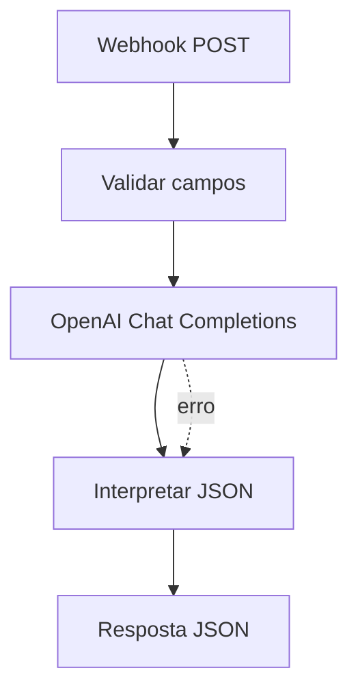

# Arquitetura do workflow

## Visão geral

O workflow utiliza um endpoint Webhook como entrada e devolve uma resposta JSON ao sistema chamador. A análise textual é feita por meio da API da OpenAI.

## Nodes

### 1. Receber solicitação — Webhook
- Método: `POST`
- Caminho: `triagem-solicitacoes`
- Modo de resposta: por meio do node Respond to Webhook.

O node aceita um JSON com nome, e-mail, assunto e mensagem.

### 2. Validar e organizar dados — Code
Lê o corpo da requisição (ou o JSON recebido diretamente), normaliza os campos e interrompe o fluxo quando `assunto` ou `mensagem` estiverem vazios.

### 3. Classificar com OpenAI — HTTP Request
Envia os dados para `POST https://api.openai.com/v1/chat/completions`, usando uma credencial Header Auth configurada no n8n. O prompt solicita um JSON com:
- `categoria`
- `prioridade`
- `resumo`
- `justificativa`
- `resposta_sugerida`

### 4. Formatar resultado da triagem — Code
Interpreta o conteúdo retornado pela API e cria uma resposta padronizada. Se a chamada falhar ou o conteúdo não for JSON válido, retorna uma mensagem de falha para encaminhamento manual.

### 5. Responder solicitante — Respond to Webhook
Devolve o resultado ao sistema que enviou a requisição.

## Diagrama



## Contrato de entrada

```json
{
  "nome": "Maria Silva",
  "email": "maria@example.com",
  "assunto": "Acesso à conta",
  "mensagem": "Não consigo redefinir minha senha."
}
```

`assunto` e `mensagem` são obrigatórios. `nome` e `email` são opcionais.

## Contrato de saída

Em caso de sucesso, o retorno contém `sucesso`, `solicitacao`, `triagem` e `observacao`. Em caso de falha, contém `sucesso: false`, uma mensagem e, quando disponível, os dados da solicitação.

A classificação é uma sugestão automatizada, não uma decisão definitiva.
