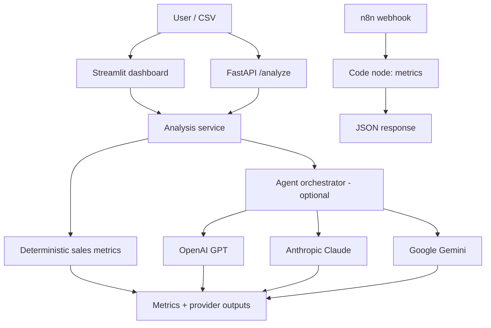

# Architecture

The deterministic calculation layer works without an LLM key. The provider layer is optional
and each provider failure is reported separately. Provider responses are advisory, not
automatically executed actions. The n8n workflow independently demonstrates webhook-based
sales-metric automation.

## Trust boundaries
- API keys are loaded from environment variables and must never be committed.
- Uploaded CSV files are processed in memory by the dashboard.
- AI output can be inaccurate; a human should review recommendations.
- Sample data is synthetic and must not be described as real business impact.
