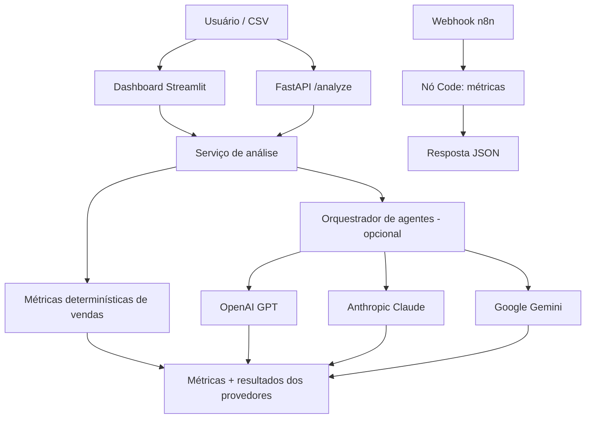

# Arquitetura

A camada de cálculos determinísticos funciona sem uma chave de API de modelos de linguagem. A camada de provedores é opcional, e eventuais falhas de cada provedor são informadas separadamente. As respostas dos provedores servem como apoio à análise e não executam ações automaticamente. O fluxo do n8n demonstra, de forma independente, uma automação de métricas de vendas acionada por webhook.

## Limites de confiança e segurança
- As chaves de API são carregadas por variáveis de ambiente e nunca devem ser enviadas ao repositório.
- Os arquivos CSV enviados pelo usuário são processados em memória pelo dashboard.
- As respostas geradas por IA podem conter imprecisões; as recomendações devem ser revisadas por uma pessoa.
- Os dados de exemplo são sintéticos e não devem ser apresentados como resultados reais de impacto em uma empresa.
